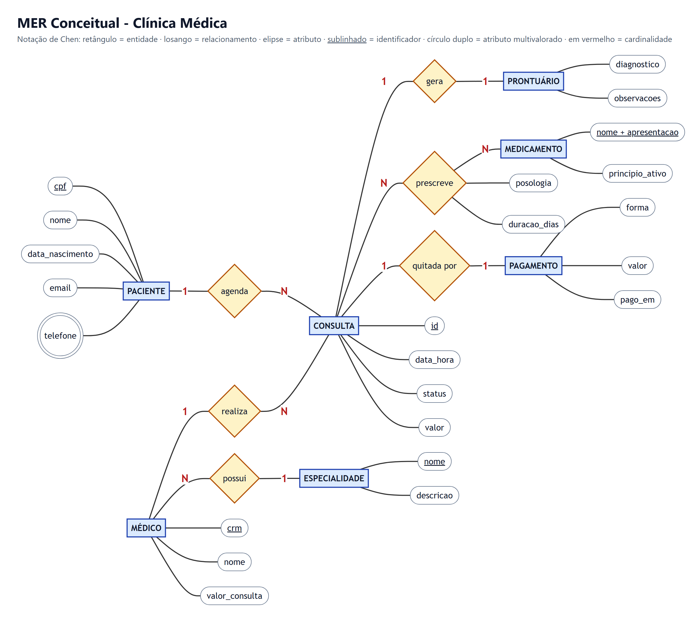
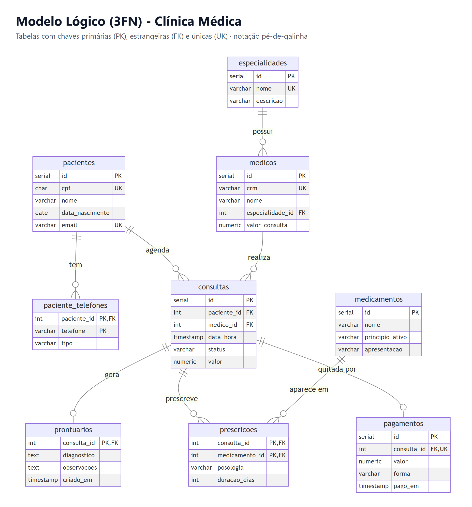

# Clínica Médica: Modelagem Conceitual, Lógica e Normalização

Entregável da Semana 15 da disciplina **Modelagem de Banco de Dados**. Continua o escopo definido na Semana 14 ([clinica-medica-db](https://github.com/marciowsz/clinica-medica-db)): sistema de **agendamento, atendimento e pagamento de uma clínica médica**, em **PostgreSQL**.

**Autor:** Marcio Rogério Reis Freire Junior ([@marciowsz](https://github.com/marciowsz))

```
clinica-medica-modelagem/
├── docs/
│   ├── MER.png                    # MER conceitual (notação de Chen)
│   ├── modelo-logico.png          # Modelo lógico normalizado (3FN)
│   ├── MER-e-modelo-logico.pdf    # os dois diagramas em PDF
│   ├── mer.mmd                    # fonte do MER (Mermaid)
│   └── modelo-logico.mmd          # fonte do modelo lógico (Mermaid)
├── database/
│   ├── 01_ddl.sql                 # CREATE TABLE com PRIMARY KEY e FOREIGN KEY
│   ├── 02_dml.sql                 # INSERT INTO de dados de teste + JOINs
│   └── 03_integridade.sql         # bônus: violação de FK e de PK
└── .github/workflows/
    └── validar-banco.yml          # roda os 3 scripts em um PostgreSQL a cada push
```

---

## Parte 1: Modelagem conceitual (MER)



> O MER é **conceitual**: tem **entidades, atributos e relacionamentos**, não tabelas. As tabelas aparecem só no modelo lógico (Parte 2). Versão em PDF: [docs/MER-e-modelo-logico.pdf](docs/MER-e-modelo-logico.pdf).

### Entidades e atributos

| Entidade | Identificador | Atributos |
|---|---|---|
| **PACIENTE** | <u>cpf</u> | nome, data_nascimento, email, **telefone** (multivalorado) |
| **MÉDICO** | <u>crm</u> | nome, valor_consulta |
| **ESPECIALIDADE** | <u>nome</u> | descricao |
| **CONSULTA** | <u>id</u> | data_hora, status, valor |
| **PRONTUÁRIO** | (da consulta) | diagnostico, observacoes |
| **MEDICAMENTO** | <u>nome + apresentacao</u> | principio_ativo |
| **PAGAMENTO** | (da consulta) | forma, valor, pago_em |

### Relacionamentos e cardinalidade

| Relacionamento | Entidades | Cardinalidade | Leitura |
|---|---|---|---|
| **agenda** | Paciente → Consulta | **1:N** | Um paciente agenda várias consultas; cada consulta é de um paciente. |
| **realiza** | Médico → Consulta | **1:N** | Um médico realiza várias consultas; cada consulta tem um médico. |
| **possui** | Médico → Especialidade | **N:1** | Vários médicos têm a mesma especialidade; cada médico tem uma especialidade. |
| **gera** | Consulta → Prontuário | **1:1** | Uma consulta realizada gera um prontuário (opcional: consulta só agendada ainda não tem). |
| **quitada por** | Consulta → Pagamento | **1:1** | Uma consulta é paga uma única vez. |
| **prescreve** | Consulta ↔ Medicamento | **N:N** | Uma consulta prescreve vários medicamentos e um medicamento aparece em várias consultas. O relacionamento tem atributos próprios: **posologia** e **duracao_dias**. |

---

## Parte 2: Modelo lógico, normalização e chaves



### Do conceitual para o lógico

| Regra de transformação | Onde foi aplicada |
|---|---|
| Cada **entidade** vira uma **tabela** com PK própria | `pacientes`, `medicos`, `especialidades`, `consultas`, `medicamentos`, `pagamentos` |
| Relacionamento **1:N** → a **FK fica no lado N** | `consultas.paciente_id`, `consultas.medico_id`, `medicos.especialidade_id` |
| Relacionamento **1:1** → FK com `UNIQUE`, ou **PK = FK** | `prontuarios.consulta_id` é PK **e** FK; `pagamentos.consulta_id` é FK `UNIQUE` |
| Relacionamento **N:N** → **tabela associativa** com PK composta pelas duas FKs | `prescricoes (consulta_id, medicamento_id)` guarda também `posologia` e `duracao_dias` |
| Atributo **multivalorado** → tabela própria (1FN) | `paciente_telefones (paciente_id, telefone)` |

### Chaves primárias (PK) e estrangeiras (FK)

| Tabela | PK | FKs | Outras restrições |
|---|---|---|---|
| `especialidades` | `id` | — | `nome UNIQUE` |
| `pacientes` | `id` | — | `cpf UNIQUE` + `CHECK` (11 dígitos), `email UNIQUE` |
| `paciente_telefones` | (`paciente_id`, `telefone`) | `paciente_id → pacientes.id` (`ON DELETE CASCADE`) | `CHECK` no formato e no tipo |
| `medicos` | `id` | `especialidade_id → especialidades.id` | `crm UNIQUE`, `CHECK (valor_consulta > 0)` |
| `consultas` | `id` | `paciente_id → pacientes.id`, `medico_id → medicos.id` | `CHECK` do status, índice único (médico, horário) |
| `prontuarios` | `consulta_id` | `consulta_id → consultas.id` | PK = FK garante o 1:1 |
| `medicamentos` | `id` | — | `UNIQUE (nome, apresentacao)` |
| `prescricoes` | (`consulta_id`, `medicamento_id`) | `consulta_id → consultas.id`, `medicamento_id → medicamentos.id` | `CHECK (duracao_dias > 0)` |
| `pagamentos` | `id` | `consulta_id → consultas.id` | `consulta_id UNIQUE`, `CHECK (valor > 0)` |

O script DDL completo está em [`database/01_ddl.sql`](database/01_ddl.sql).

### Aplicação das formas normais

- **1FN (atributos atômicos):** cada coluna guarda um único valor. O telefone, que é multivalorado (celular, residencial...), saiu de `pacientes` e virou a tabela `paciente_telefones`, com uma linha por número. Os medicamentos de uma receita também não ficam em uma coluna de texto do tipo `"Amoxicilina, Dipirona"`: cada um é uma linha em `prescricoes`.
- **2FN (sem dependência parcial):** só importa nas tabelas com **PK composta**. Em `prescricoes (consulta_id, medicamento_id)`, `posologia` e `duracao_dias` dependem da **chave inteira** (desse medicamento nesta consulta). Já `principio_ativo` e `apresentacao` dependem só de `medicamento_id`, então ficam em `medicamentos` e não em `prescricoes`. O mesmo vale para `paciente_telefones`: o nome do paciente depende só de `paciente_id`, por isso fica em `pacientes`.
- **3FN (sem dependência transitiva):** nenhum atributo comum depende de outro atributo comum.
  - A descrição da especialidade depende da especialidade e não do médico (`medico → especialidade → descricao`). Por isso foi criada a tabela `especialidades` e `medicos` guarda só `especialidade_id`.
  - `consultas` não guarda nome do paciente nem nome do médico. Esses dados são obtidos pelas FKs com `JOIN`.
  - **Não há colunas calculadas** (como um "total da receita" ou "quantidade de consultas"). Elas são obtidas por consulta (`SUM`, `COUNT`).
  - **Observação:** `consultas.valor` **não** é redundância com `medicos.valor_consulta`. É o preço **cobrado naquela consulta**, um fato histórico. Se o médico reajustar o preço, as consultas antigas precisam continuar com o valor original.

---

## Parte 3: Desafio

### Execução do DDL e inserção de dados de teste

```bash
createdb clinica_medica
psql -d clinica_medica -f database/01_ddl.sql            # cria as 9 tabelas
psql -d clinica_medica -f database/02_dml.sql            # INSERT INTO + JOINs
psql -d clinica_medica -f database/03_integridade.sql    # bônus
```

Com Docker:

```bash
docker run -d --name clinica -e POSTGRES_PASSWORD=postgres -e POSTGRES_DB=clinica_medica -p 5432:5432 postgres:16
docker exec -i clinica psql -U postgres -d clinica_medica < database/01_ddl.sql
docker exec -i clinica psql -U postgres -d clinica_medica < database/02_dml.sql
docker exec -i clinica psql -U postgres -d clinica_medica < database/03_integridade.sql
```

O [`02_dml.sql`](database/02_dml.sql) insere dados em **todas as tabelas relacionadas** (especialidade → médico → consulta → prontuário/prescrição/pagamento). Em seguida, os `JOIN`s comprovam que as FKs ligam os registros corretamente:

```
 id |   paciente    |       medico        | especialidade |      data_hora      |  status
----+---------------+---------------------+---------------+---------------------+-----------
  1 | Ana Souza     | Dr. Paulo Lima      | Cardiologia   | 2026-12-01 09:00:00 | REALIZADA
  2 | Bruno Almeida | Dr. Paulo Lima      | Cardiologia   | 2026-12-01 09:30:00 | AGENDADA
  3 | Carla Mendes  | Dra. Fernanda Rocha | Pediatria     | 2026-12-01 10:00:00 | REALIZADA

   paciente   | medicamento |     apresentacao      |            posologia             | duracao_dias
--------------+-------------+-----------------------+----------------------------------+--------------
 Carla Mendes | Amoxicilina | 250 mg/5 ml suspensao | 5 ml a cada 8 horas              |           10
 Carla Mendes | Dipirona    | 500 mg/ml gotas       | 15 gotas se febre, ate 4x ao dia |            5
```

### Bônus: erro de integridade referencial e de PK duplicada

O [`03_integridade.sql`](database/03_integridade.sql) tenta gravar dados inválidos e mostra a mensagem real do PostgreSQL:

```
NOTICE: [FK] recusado -> inserção ou atualização em tabela "consultas" viola restrição de chave estrangeira "consultas_paciente_id_fkey"
NOTICE: [FK] recusado -> inserção ou atualização em tabela "prescricoes" viola restrição de chave estrangeira "prescricoes_medicamento_id_fkey"
NOTICE: [PK] recusado -> duplicar valor da chave viola a restrição de unicidade "pacientes_pkey"
NOTICE: [PK composta] recusado -> duplicar valor da chave viola a restrição de unicidade "prescricoes_pkey"
NOTICE: [1:1] recusado -> duplicar valor da chave viola a restrição de unicidade "prontuarios_pkey"
NOTICE: [FK - DELETE] recusado -> atualização ou exclusão em tabela "medicos" viola restrição de chave estrangeira "consultas_medico_id_fkey" em "consultas"
NOTICE: [OK] integridade preservada: nenhum dado invalido foi gravado
```

| Teste | Comando | Por que o banco recusa |
|---|---|---|
| FK inexistente | consulta com `paciente_id = 999` | Não existe paciente 999: a consulta ficaria "órfã". |
| FK inexistente | prescrição com `medicamento_id = 999` | Não existe medicamento 999. |
| PK duplicada | paciente com `id = 1` | Já existe um paciente com essa PK. |
| PK composta duplicada | mesmo medicamento duas vezes na consulta 3 | O par (`consulta_id`, `medicamento_id`) já existe. |
| 1:1 | segundo prontuário para a consulta 1 | A PK de `prontuarios` é a própria `consulta_id`. |
| Exclusão | `DELETE` do médico 1 | Ele tem consultas: apagar deixaria registros órfãos. |

> Em inglês (padrão do PostgreSQL no GitHub Actions) as mensagens são `violates foreign key constraint` e `duplicate key value violates unique constraint`.

O workflow [`validar-banco.yml`](.github/workflows/validar-banco.yml) roda os três scripts em um PostgreSQL 16 a cada push e falha se algum dado inválido for aceito.

### Desafio de normalização: tabela desnormalizada × 3FN

Antes da modelagem, a clínica controlava tudo em **uma única planilha**:

| consulta | paciente | cpf | telefones | medico | crm | especialidade | desc_especialidade | data_hora | medicamentos |
|---|---|---|---|---|---|---|---|---|---|
| 1 | Ana Souza | 12345678901 | 98999990001, 9832220001 | Dr. Paulo Lima | 10234-MA | Cardiologia | Doenças do coração... | 01/12 09:00 | Losartana 50mg |
| 2 | Bruno Almeida | 23456789012 | 98999990002 | Dr. Paulo Lima | 10234-MA | Cardiologia | Doenças do coração... | 01/12 09:30 | |
| 3 | Carla Mendes | 34567890123 | 98999990003 | Dra. Fernanda Rocha | 20456-MA | Pediatria | Saúde de crianças... | 01/12 10:00 | Amoxicilina 250mg, Dipirona 500mg |
| 4 | Ana Souza | 12345678901 | 98999990001 | Dr. Paulo Lima | 10234-MA | Cardiologia | Doenças do coração... | 15/12 09:00 | |

**Anomalias desta tabela:**
- **Dados duplicados:** o nome, o CRM e a descrição da Cardiologia se repetem em toda consulta do Dr. Paulo.
- **Anomalia de atualização:** se a Ana trocar de telefone, é preciso alterar todas as linhas dela. Repare que a linha 4 já está **inconsistente**: tem só um dos telefones.
- **Anomalia de inserção:** não dá para cadastrar um médico recém-contratado ou um medicamento novo sem inventar uma consulta para ele.
- **Anomalia de exclusão:** se a consulta 3 for apagada, a clínica **perde** a informação de que a Pediatria existe e de que a Dra. Fernanda trabalha lá.
- **Atributos não atômicos:** `telefones` e `medicamentos` guardam listas. Buscar "quem tomou Dipirona" exige procurar texto dentro da coluna.

**Como a normalização resolveu:**

| Forma normal | Problema | Solução no modelo |
|---|---|---|
| **1FN** | `telefones` e `medicamentos` com vários valores na mesma célula | Tabelas `paciente_telefones` e `prescricoes`, com uma linha por valor |
| **2FN** | Em `prescricoes`, o `principio_ativo` dependeria só do medicamento e não da chave inteira (consulta + medicamento) | Os dados do medicamento ficam em `medicamentos`; `prescricoes` guarda só o que depende das duas chaves (posologia, duração) |
| **3FN** | `desc_especialidade` depende de `especialidade`, que depende do médico (dependência transitiva); nome e telefone do paciente dependem do CPF, não da consulta | Tabelas `especialidades`, `medicos` e `pacientes`; `consultas` guarda só as FKs |

Resultado: cada informação é gravada **em um único lugar**. Trocar o telefone da Ana é **um `UPDATE` em uma linha**, um médico novo é cadastrado sem consulta, e apagar uma consulta não apaga médico nem especialidade.

---

## Parte 4: Reflexão

### Por que a normalização (até a 3FN) é crucial para evitar anomalias de inserção, atualização e exclusão? Qual o papel da PK e da FK na integridade dos dados?

A normalização organiza os dados para que **cada fato seja armazenado em um único lugar**. Quando a mesma informação aparece em várias linhas, como o nome do médico repetido em cada consulta, o banco passa a depender de que **todas as cópias** sejam mantidas iguais para sempre. Na prática isso falha, e surgem as três anomalias:

- **Inserção:** não é possível registrar um fato sem registrar outro que não existe ainda. Por exemplo, cadastrar um médico só é possível junto com uma consulta.
- **Atualização:** alterar um dado exige atualizar várias linhas. Se uma for esquecida, o banco fica **inconsistente**, com duas "verdades" para a mesma informação.
- **Exclusão:** apagar um registro leva junto informações que deveriam continuar existindo. Apagar a última consulta de uma especialidade apaga a especialidade.

Cada forma normal elimina uma causa dessa **redundância**. A **1FN** garante valores atômicos, que podem ser pesquisados e validados. A **2FN** tira atributos que dependem só de parte da chave. A **3FN** tira atributos que dependem de outro atributo comum. No fim, cada tabela trata de **um único assunto** e cada coluna depende "da chave, da chave inteira e de nada além da chave". O resultado é um banco **sem redundância e sem inconsistência**, mais fácil de manter e que ocupa menos espaço.

A normalização **separa** os dados em várias tabelas. As **chaves** garantem que essas partes continuem **corretamente ligadas**:

- A **Chave Primária (PK)** garante que **cada registro seja único e identificável**: não existem dois pacientes com o mesmo `id`, nem o mesmo medicamento duas vezes na mesma receita (PK composta). Sem a PK, não haveria como apontar com segurança para "aquele" registro.
- A **Chave Estrangeira (FK)** garante a **integridade referencial**: toda referência aponta para algo que existe de verdade. O banco recusa uma consulta de um paciente inexistente e impede apagar um médico que tem consultas. Assim **nenhum relacionamento fica "órfão"**.

O mais importante é que essas regras são garantidas **pelo próprio SGBD**, e não pela boa vontade do código da aplicação. Mesmo com um bug, um acesso direto ao banco ou duas requisições ao mesmo tempo, o PostgreSQL recusa o dado inválido, como mostra o bônus da Parte 3. Normalização e chaves juntas são a base de um sistema transacional (OLTP) **confiável**.
